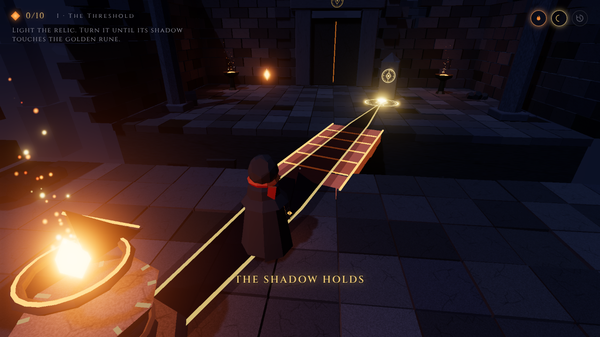
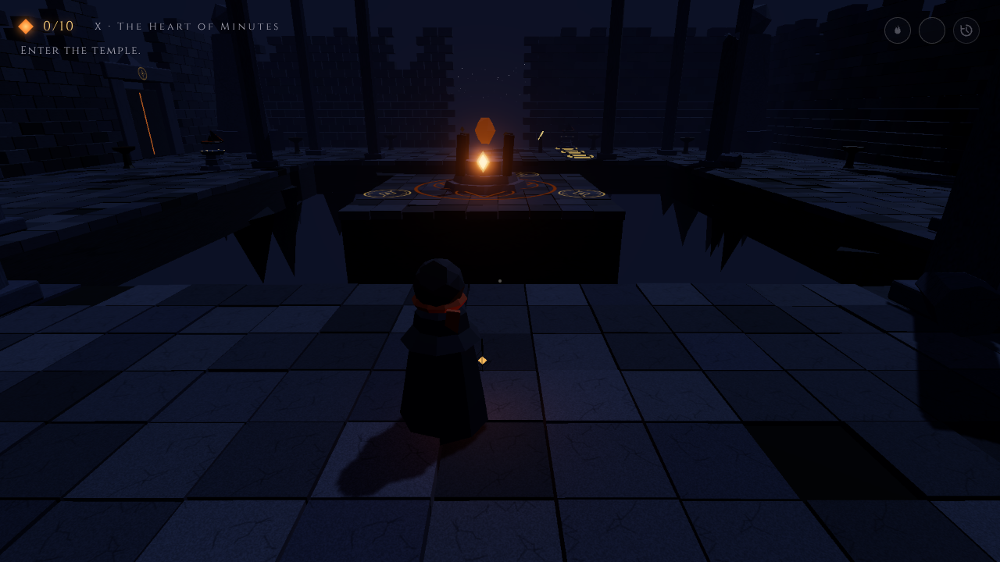

# Ashen Minutes

*The temple remembers what the world has forgotten.*

A third-person puzzle adventure in **one connected ancient temple**, built in Three.js for a game jam with the themes **Fire, Shadow and Time**. You play Ilen, a former apprentice Keeper, who returns to relight the Heart Ember while the city below forgets itself. There are ten levels in a persistent, explorable world, with in-engine cutscenes and a complete story. A run takes about 30–50 minutes.



## How the themes work together

Every relic is a floating stone **sundial**.

| Theme | Mechanic |
|---|---|
| **Fire** | Press **E** to ignite a relic. *Cold* relics must be **kindled** with a flame you carry in your lantern from an eternal hearth, and it burns down in 10–14 seconds. Fire can also **relay** along a shadow to light another relic. |
| **Shadow** | A lit relic casts its gnomon's detached shadow. When the shadow lands on a golden rune, it hardens into a **bridge**, opens a **gate**, **relays** fire onward, or fills a **socket** of the Heart. A shadow that lands on the wrong sign is rejected. |
| **Time** | Hold **R** to **rewind the relic's own recorded memory**. Relics are jolted on ignition and their stone collars only allow small nudges, so the right angle exists only in their past. Bridges can also be **timed**. |

Fire reveals the shadow, the shadow forms the route, and time recovers the angle that makes the route possible. The world also reacts as you progress: each restored ember lights one brazier in the Sanctuary and warms the temple's light, fog and music.

## The temple



- **Entrance → I The Threshold → gallery → the Sanctuary (hub).**
- **West wing:** II The Echo Court → III The Twin Flames → IV The Measured Shadow, then a shortcut back to the hub.
- **North wing:** V The Bent Memory → VI The Relay → VII The Crossroads, then a shortcut back.
- **East wing:** VIII The Clockwork Span → IX The Mirror Hall, then a shortcut back.
- **X The Heart of Minutes** happens in the Sanctuary itself, where three ring relics must hold their shadows on the Heart at the same time.

Every gate is a real door with collision. Opened gates stay open, and progress is saved automatically (**Continue** on the title screen). There are three optional inscriptions to find.

Full puzzle specification: [`docs/LEVEL_DESIGN.md`](docs/LEVEL_DESIGN.md) · Story: [`docs/STORY.md`](docs/STORY.md)

## Controls

| Input | Action |
|---|---|
| W A S D | Move relative to the camera · **Shift** to run |
| Mouse / wheel | Orbit the camera / camera distance (click the game to capture the mouse) |
| E | Ignite · take flame · kindle · slide a rail relic (at its lever) · read inscriptions |
| A D or ← → beside a lit relic | Turn or nudge the relic |
| Hold R | Rewind the relic's memory |
| Hold Q | Focus: shadow line and memory trail |
| Space | Hop · advance dialogue |
| Backspace | Restart the current puzzle (gates stay open) |
| Esc | Pause · skip cutscene |
| M | Mute |

## Running it

You need Node.js 18 or newer.

```bash
npm install
npm run dev        # open http://localhost:5173
npm run build      # production build in dist/ (static, deployable anywhere)
```

**Settings → Low / Medium / High** cover render scale, shadows, bloom, particles, the number of real lights, mouse sensitivity, invert-Y and an FPS counter. Medium is the default. URL flags `?lowfx` and `?highfx` force a preset.

## Technical notes

- **Camera:** a spring-arm third-person rig. The mouse controls the camera's yaw and pitch, with pitch clamped. A 5-ray collision probe pulls the camera in front of walls. The shoulder offset shrinks in corridors. The look direction comes straight from yaw and pitch, so "W = forward" always matches the screen. (This fixed the earlier bug where the title-screen camera stayed active during play.)
- **Movement:** camera-relative and normalised, simulated in fixed steps of at most 1/30 s, so it behaves the same at any frame rate. Held keys are released when the window loses focus.
- **Puzzles:** fully data-driven (`src/world/levels.js`, `src/game/Puzzle.js`). Shadows are designed guides, never taken from renderer shadow maps. A bridge's collider turns on only when the bridge is fully formed. Only the relic's own rotation is rewound. Every failure can be recovered.
- **Performance:** fire lights are drawn from a small fixed pool of real lights; repeated parts are merged or instanced; zones are culled by distance; collision uses a spatial grid; one shadow-casting light follows the player. See [`docs/PERFORMANCE.md`](docs/PERFORMANCE.md).

```
src/game/    Game loop & states, Input, PlayerController, CameraController, CollisionWorld,
             Puzzle (multi-relic logic), TimeRecorder, LightPool, Settings, UI, Audio, Effects
src/world/   levels.js (temple layout + 10 level specs), World.js (build/progress/culling), Progress.js (save)
src/story/   script.js (all dialogue, scenes, inscriptions), Story.js (cutscene & bark director)
src/objects/ procedural models: Keeper, Relic, ShadowGuide, ShadowBridge, TargetRune, Gate, HeartEmber, Environment kit
tests/       playthrough.py (all 10 levels, 120 checks), perf.py, capture.py, audio_check.py, smoke.py
```

## Testing

```bash
npm run build && npx vite preview --port 4173 &
python3 tests/playthrough.py     # needs Python Playwright
python3 tests/perf.py            # draw calls / triangles / CPU step per area
python3 tests/audio_check.py
```

The playthrough sends **real keyboard events** and solves all ten levels. It walks every bridge and gate on the critical path, and also checks the controls at four camera angles, camera collision, focus loss, cutscene skipping, wrong-solution cases, timer pause and expiry, and save/continue. Latest result: **120/120**. See [`docs/TEST_CHECKLIST.md`](docs/TEST_CHECKLIST.md).

## Assets and licences

- **Code:** MIT.
- **Everything visual and audible** (models, textures, glyphs, particles, music drone and sound effects) is generated by this repository's code at runtime. No third-party art or audio is used.
- **Fonts:** Cinzel and Inter, under the SIL Open Font License 1.1.
- **Libraries:** three.js and Vite, both MIT.

See [`docs/ASSETS_LICENSES.md`](docs/ASSETS_LICENSES.md).
