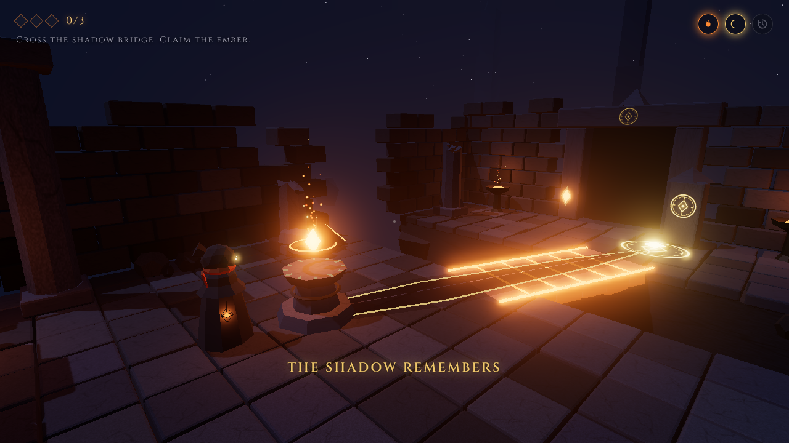

# Ashen Minutes

*The temple remembers what the world has forgotten.*

A short 3D third-person puzzle game about a hooded Keeper relighting a ruined temple. Built in Three.js for a game-jam with the themes **Fire, Shadow and Time**. It takes about 5–8 minutes to finish.



## How the three themes work together

Each relic in the temple is a floating stone **sundial**. Its parts make up a single puzzle that chains the three themes:

| Theme | In the game |
|---|---|
| **Fire** | You press **E** to ignite the relic's ember core. Until it burns there is no shadow, no target and no way forward. The braziers around the room catch fire from the relic. Each ember you restore warms the Keeper's lantern, the light and the music. |
| **Shadow** | The burning relic casts its sundial gnomon's **detached shadow** across the floor and over the abyss. You turn the relic until the shadow's tip lands on a golden rune. When it does, the shadow becomes a **solid bridge** that you walk across. |
| **Time** | You hold **R** to **rewind the relic's own recent memory** (its rotation history). This affects only the relic, never the world or the player. In later rooms the useful angle survives only in that memory. |

The dependency always runs the same way: **Fire** reveals the shadow, **Shadow** forms the route, and **Time** corrects the relic so the route can form.

## The three rooms

1. **The First Ember.** Ignite the relic, turn it until its shadow meets the rune, and cross the bridge. This room teaches the core loop.
2. **The Bent Memory.** Igniting the relic wrenches it far off course, and its stone collar only lets you nudge it ±15°. A cyan echo shows the angle it remembers. Rewind back to the echo, then fine-tune.
3. **The Ashen Span.** The relic is thrown back and forth, so its memory zig-zags. Rewind it, align it to within 5°, and cross before the bridge fades after 8 seconds. The timer pauses while you stand on the span. If the span fades, the relic slips again, and you can rewind it back into place.
4. **Finale.** The three embers converge on the Heart Ember, the floor seal completes and the sealed arch opens.

## Controls

| Input | Action |
|---|---|
| W A S D | Move (relative to the camera) |
| Mouse | Look (click the game to capture the mouse; dragging also works) |
| E | Ignite the relic |
| A / D or ← / → (beside a lit relic) | Turn or nudge the relic |
| Hold R | Rewind the relic's memory |
| Hold Q | Focus: shows the shadow line and the relic's recent path |
| Space | Small hop (never required) |
| Backspace | Restart the room (embers you've earned are kept) |
| Esc | Pause |
| M | Mute |

## Running it

You need Node.js 18 or newer.

```bash
npm install
npm run dev        # open the printed http://localhost:5173 link
npm run build      # production build in dist/
npm run preview    # serve the production build
```

Optional URL flags:
- `?lowfx` turns off bloom and shadows, for weak GPUs.
- `?nofallback` turns off automatic quality reduction.

Without `?nofallback`, the game watches the frame rate during the first seconds of play. If it runs slowly, it lowers the resolution first and then turns off bloom.

**Deploying (optional):** the `dist/` folder is a static site and works on Vercel, Netlify, GitHub Pages or itch.io. `vite.config.js` uses a relative base path, so the game also runs from a sub-folder.

## Project structure

```
index.html                 UI markup (title, HUD, pause, victory, controls, credits)
src/main.js                entry point
src/game/Game.js           renderer, lighting, post-processing, main loop with fixed sub-steps, top-level states
src/game/Input.js          keys, edge-triggered presses, mouse look, clears held keys when the window loses focus
src/game/PlayerController.js  camera-relative movement, collision, falling and respawn
src/game/CameraController.js  over-the-shoulder camera, pitch clamp, pulls in near walls
src/game/CollisionWorld.js oriented boxes for floors, walls and bridges (never taken from meshes)
src/game/PuzzleManager.js  per-room state machine: INTRO → UNLIT → IGNITING → ALIGNING → BRIDGE_* → EXIT_REACHED → COMPLETE
src/game/TimeRecorder.js   20 Hz, 4 s history of the relic's rotation; rewind playback
src/game/LevelManager.js   room loading and reset, ember awards, transitions, Heart Ember finale
src/game/UIManager.js      HUD, prompts, timer ring, memory bar, menus
src/game/AudioManager.js   every sound effect and ambience synthesised with the Web Audio API
src/game/Effects.js        capped, reused particle pools (fire, time sparks, falling ash)
src/objects/*              procedural models: Keeper, Relic, ShadowGuide, ShadowBridge, TargetRune, HeartEmber, EmberPickup, Environment kit, Glyphs
src/levels/level1-3.js     data-driven room definitions (layout, angles, tolerances, timer)
tests/                     automated playthrough, screenshot capture, offline audio check
docs/                      asset manifest, licences, test checklist, trailer plan, screenshots
```

## Design notes and deviations from the design bible

These implementation decisions go beyond or refine `Ashen_Minutes_Master_Design_and_Asset_Bible_v3.pdf`:

- **The shadow guide is designed, not computed.** It is a mesh that follows the relic's rotation. The bridge is a predefined set of slabs whose collider switches on only once the slabs are fully in place, and switches off the moment they start to fade.
- **Alignment is checked by angle only:** the shortest wrapped difference to the target angle. Tolerances are 8°, 6° and 5° for the three rooms.
- **The relic locks when aligned.** It snaps exactly onto the target, so you can't overshoot and make the bridge vanish.
- **The collar (Rooms 2–3) is an addition.** Without it, free rotation would make rewinding optional. The scripted jolt on ignition never passes through the solution angle, so you have to rewind.
- **The echo angle is a pinned memory.** Only movement is recorded, and the first sample is never evicted. You can't erase the memory the puzzle needs, however long you fiddle with the relic.
- **When Room 3's span expires, the relic slips 70°.** You re-align it with a short rewind instead of restarting the room.
- **The simulation runs in fixed sub-steps of 1/30 s or less.** On slow machines the game keeps real-time speed without the Keeper tunnelling through walls.

## Testing

```bash
npm run build && npx vite preview --port 4173 &
python3 tests/playthrough.py      # full start-to-victory run with real key presses (needs Python Playwright)
python3 tests/capture.py          # full-quality screenshots into docs/screenshots
python3 tests/audio_check.py      # renders every synthesised sound offline and checks its levels
```

`docs/TEST_CHECKLIST.md` lists the automated and manual checks and their latest results.

## Assets and licences

- **Code:** MIT (see `LICENSE`).
- **3D models, textures, glyphs, particles and audio:** all original and generated procedurally at runtime by this repository's code. No third-party models, textures or sounds are used.
- **Fonts:** Cinzel and Inter, bundled through `@fontsource`, under the SIL Open Font License 1.1.
- **Libraries:** three.js (MIT) and Vite (MIT).

See `docs/ASSETS_LICENSES.md` and `docs/ASSET_MANIFEST.csv`.
