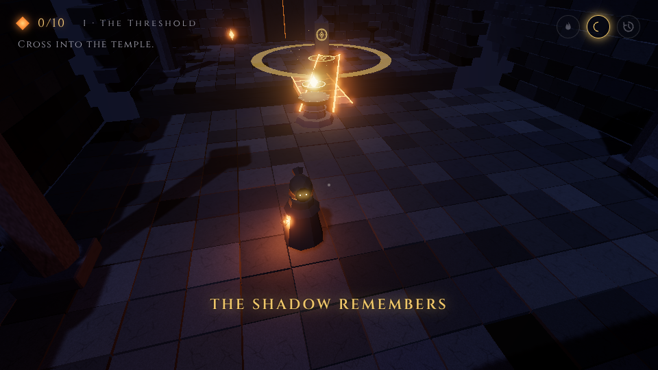
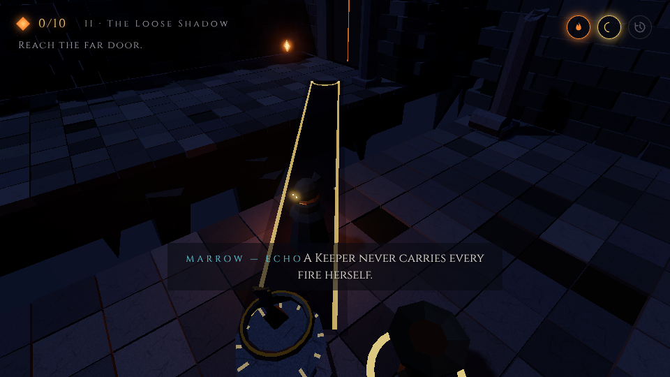
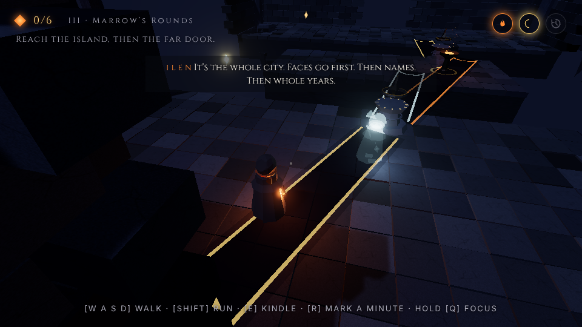
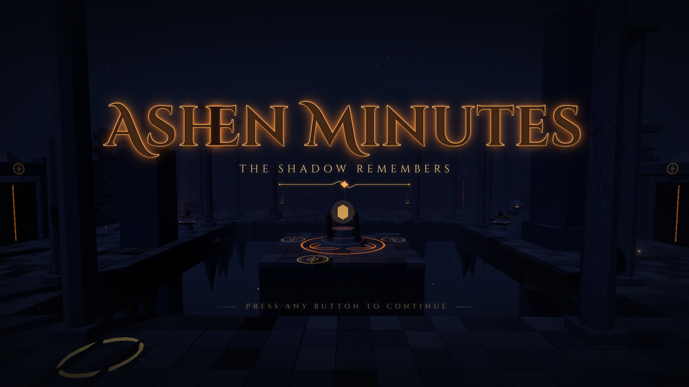
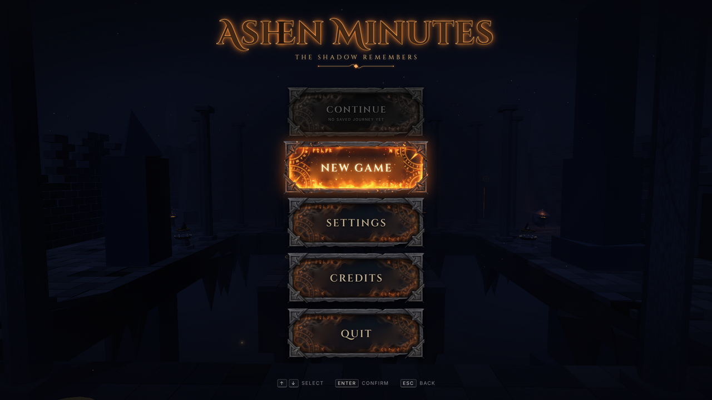

# Ashen Minutes

*The temple remembers what the world has forgotten.*

A third-person puzzle adventure in **one connected ancient temple**, built in Three.js for a game jam with the themes **Fire, Shadow and Time**. You play Ilen, a former apprentice Keeper, who returns to relight the Heart Ember while the city below forgets itself. Six rooms, the Heart, an escape, six optional Lost Minutes, in-engine cutscenes and a complete story. The target for a first run is 15–20 minutes (not yet timed with real players).



## You are the light

Ilen carries the only moving sun in a temple of sundials. The gnomon stones never turn — **you aim their shadows by walking**. Five rules govern everything, and the game teaches them by play, never by text:

1. **Every fire casts every nearby stone's shadow directly away from itself.** Ilen's lantern is a fire. (Step back and the shadow grows.)
2. **A shadow lying over the abyss is solid ground while it lasts.** (But you can never walk a shadow you cast yourself: to step on it you must pass the stone, and then the light — you — is on the wrong side.)
3. **A shadow that rests on a rune wakes it:** a gate opens, a bridge forms, fire is relayed, a Heart socket holds.
4. **A shadow that touches an unlit sconce sets it alight,** and a lit sconce is a new fire.
5. **Ilen can mark a minute.** Her **echo** walks that minute again carrying its own fire, holds the light for a while, then crumbles to ash.

| Theme | In play |
|---|---|
| **Fire** | Ilen's lantern and every sconce are lights. Kindle a sconce with **E**; it burns for 20 s. A shadow touching a sconce lights it, so fire runs along shadows. |
| **Shadow** | Cast by those fires, away from them. Walkable over the abyss, it wakes runes and lights sconces. Moving shadows carry you. |
| **Time** | **R** marks a minute; your echo replays it and holds its lantern up for 12 s — another light, standing where you can't. In the finale, two echoes stay forever: the price of the ending. |



## The temple

| Room | Introduces → twist |
|---|---|
| I · The Threshold | Walking swings the shadow → it falls short until you step *back* |
| II · The Loose Shadow | Your own shadow swings away as you step on it → kindle a sconce; the near one is too short, the far one reaches |
| III · Marrow's Rounds | Marrow's echo walks her rounds; her lantern sweeps a shadow across the gap → kindle the island sconce for the second gap |
| IV · The Kept Minute | Gain the echo; it holds a shadow while you cross → stand *on* your own past over the abyss to cast a second stone onto the door rune |
| V · The Fire Road | Sweep a shadow across a gallery of sconces → throw a shadow across the abyss onto a far sconce; its fire throws a road back to you |
| VI · The Mirror Hall | No lessons: relay, rail stone and echo across two gaps |
| The Heart of Minutes | Three sockets, three lights: Ilen and two echoes that never fade → the Heart burns backwards and the game ends there |

Three passages connect the wings, and shortcuts lead back to the Sanctuary (hub), whose six braziers wake as rooms are restored. Every gate is a real door; progress saves automatically (**Continue**). Optional: three inscriptions and **six Lost Minutes**, each hidden behind an extra-clever use of the rules.



Design and verification: [`docs/LEVEL_DESIGN.md`](docs/LEVEL_DESIGN.md) · Story: [`docs/STORY.md`](docs/STORY.md) · Trailer: [`docs/TRAILER_PLAN.md`](docs/TRAILER_PLAN.md)

## Title screen and menu



The game opens on the Sanctuary of Minutes: the camera drifts across the chasm toward the dead Heart altar, the six braziers kindle in pairs, and the title rests above the altar. **Press any button** (any key, a click or a gamepad button). The same title then glides up and shrinks into the menu while the camera eases in and the rune buttons kindle beneath it. Input is locked until the transition ends.

| Menu | |
|---|---|
| **Continue** | Resumes the current run from its automatic save (checkpoint, restored rooms, play clock). Offered only while a run is started and not finished; otherwise it is not shown and the menu re-centres |
| **New Game** | Starts the cold open. If a save exists, it asks first (default: *Keep it*) |
| **Settings** | Graphics, controls and sound. **Controls** opens from here; *Back* returns to Settings |
| **Credits** | |
| **Quit** | Leaves the game. In a browser a page can't close a tab the player opened, so the game says the journey is saved and the tab can be closed; any button returns to the menu |



Menu input: **↑ ↓ / W S** select · **Enter / Space / E** confirm · **Esc** back · mouse hover + click · gamepad d-pad / left stick, **A** confirm, **B** back. Returning to the main menu from the game skips the splash. The menu buttons use the provided theme sheet (`docs/reference/button-theme-sheet.jpg`), cut into normal, hover and clicked textures by `tools/extract_button_art.py`. Implementation: `src/game/TitleMenu.js`, `src/style/title.css`.

**Pause** (Esc): Resume · Restart Puzzle · Return to Checkpoint · Settings (Controls and Sound inside) · Main Menu · Quit Game. Arrow keys / W S / gamepad or mouse; Esc resumes. The world, the play clock and audio stop while paused.

**Completion:** when the ending finishes, the completion screen shows the run's time (the play clock: playing and cutscenes only, never pause or menus; carried across Continue and relaunches) with **Return to Main Menu** and **Restart Game** (a fresh run from the cold open). A finished run is no longer resumable.

## Training court (optional tutorial)

**New Game** asks **Play Tutorial** or **Skip Tutorial** (after the usual "Begin a new journey?" if a save exists). Skip starts the story exactly as before. The tutorial is a small court of the same ruined stone, set apart from the temple, that teaches the real controls one step at a time and waits until each one is done:

| Section | Teaches |
|---|---|
| The Novice Court | Mouse look · W A S D · Shift run · Space hop (over a fallen column) |
| Fire and Shadow | Shadows fall away from your lantern · a shadow on a rune wakes it (gate) · E kindles a sconce · a shadow over the abyss is walkable while it lasts · falling is safe |
| Echo of Yourself | R marks a minute, R again lets the echo walk it · it carries its own lantern, holds the light 12 s, then crumbles · one at a time, 8 s at most · you can't walk your own shadow, so leave your echo holding the light and cross |
| The Last Lessons | Hold Q to focus (which sconce reaches the rune) · E at a lever slides a stone · Backspace resets the section |

At the arch: **Training Complete** → **Begin the Story** (the normal new game) or **Main Menu**. In the court the pause menu offers Restart Section, Restart Tutorial and Skip Tutorial. Nothing in the court is saved and the play clock doesn't run; an existing journey is replaced only when the story itself begins, so leaving the tutorial keeps Continue. Code: `src/world/tutorial.js` (the court), `src/game/Tutorial.js` (the steps).

## Controls

| Input | Action |
|---|---|
| W A S D | Move relative to the camera (you carry the light: walking moves every shadow) · **Shift** run |
| Mouse / wheel | Camera / camera distance (click the game to capture the mouse) |
| E | Kindle a sconce · slide a stone at its lever · read |
| R | Mark a minute · press again to let your echo walk it |
| Hold Q | Focus: every shadow's edge, and where each unlit sconce would cast |
| Space | Hop · advance dialogue |
| Backspace | Restart the current room (doors stay open) |
| Esc | Pause · skip cutscene |
| M | Mute |

## Play on Windows

Download **`AshenMinutes-1.0.0-portable.exe`** from this repository's **Releases** page and double-click it. Nothing to install: it is a single portable file. Windows SmartScreen may warn about an unsigned app the first time (**More info → Run anyway**). **F11** toggles fullscreen; progress is saved automatically.

## Running it from source

You need Node.js 18 or newer.

```bash
npm install
npm run dev        # play in the browser at http://localhost:5173
npm run build      # production build in dist/ (static, deployable anywhere)
npm run app        # the desktop version (Electron) in a window
npm run dist:win   # build the Windows .exe → release/AshenMinutes-1.0.0-portable.exe
```

The desktop version (`electron/main.cjs`) wraps the same built game in an Electron window and serves it from a private `app://` origin, so it behaves exactly like the web build.

**Settings → Low / Medium / High** cover render scale, shadows, bloom, particles, the number of real lights, mouse sensitivity, invert-Y, camera assist and an FPS counter. `?lowfx` / `?highfx` force a preset.

## Technical notes

- **Shadows are computed, not rendered:** `ShadowSystem` gathers every light (Ilen's lantern, lit sconces, echoes, Marrow) and every stone in view, and each step computes each shadow's direction (straight away from the light), length (3 + 1.6·distance m, 3–16 m, 9 m reach), line of sight and wall clipping. Each shadow gets a pooled visual and a pooled dynamic collider you can stand on. The same function powers the game, the tests and the **light map** dev tool (`window.__ashen.debug.lightMap(id)`), which proves every room solvable and every twist un-bypassable from reachable floor.
- **Rules never lie:** a build-time check warns if any decorative fire stands within reach of a stone.
- **Fixed-step simulation** (≤ 1/30 s), no per-frame allocations in the shadow and echo loops, data-driven rooms in `src/world/levels.js`, procedural art and audio only.
- **Camera:** spring-arm third person with a 5-ray wall probe and an optional assist that looks down a little near a stone Ilen is shadowing (never takes yaw).
- **Tier 3 experiments** live behind flags in `src/game/Features.js` (all off).

```
src/game/    Game (states, play clock), Tutorial (training-court steps), TitleMenu (title → menu morph), RuneMenu (pause + completion menus), uiArt, ShadowSystem, LightPuzzle (rooms), Echo (echoes, Marrow),
             LightMap (dev tool), PlayerController, CameraController, CollisionWorld, LightPool,
             Features, Settings, UI, Audio, Effects
src/world/   levels.js (temple + six rooms, passages, the Heart), World.js, Progress.js (save v3)
src/story/   script.js (all text), Story.js (cutscenes, barks, hints, Lost Minutes)
src/objects/ procedural models: Keeper, Relic (gnomon stone), ShadowView, ShadowBridge, TargetRune,
             Gate, HeartEmber, EmberPickup, Environment kit
tests/       playthrough.py (whole game, 151 checks), title_menu.py (title + menu, 63), endgame_continue.py (48),
             tutorial_ending.py (tutorial + Heart ending, 78), features.py (12),
             perf.py, audio_check.py
tools/       extract_button_art.py (button + dialogue art), make_stone_textures.py, make_fire_loops.py
```

## Testing

```bash
npm run build && npx vite preview --port 4173 &
python3 tests/playthrough.py     # needs Python Playwright
python3 tests/title_menu.py
python3 tests/endgame_continue.py   # completion, play clock, Continue / saves, pause menu, fire
python3 tests/tutorial_ending.py    # the tutorial on foot + the Heart ending trigger
python3 tests/bench.py             # step cost, allocations, paused renders
python3 tests/features.py
python3 tests/perf.py
python3 tests/audio_check.py
```

The playthrough sends **real keyboard events** and plays the whole game from the cold open to the victory screen: every room solved on foot, every Lost Minute found, the ending at the Heart, plus rule checks (shadow direction, settle time, unwalkable own shadow, safe respawn < 1 s, burn-out warning and coyote hop, one echo at a time, no hop across any gap) and light-map bypass proofs. Latest result: **151/151**. See [`docs/TEST_CHECKLIST.md`](docs/TEST_CHECKLIST.md).

## Assets and licences

- **Code:** MIT.
- **Generated in code:** every model, particle and almost every sound.
- **Image assets:** menu / dialogue artwork cut from the author's theme sheets (`src/assets/ui/`); temple stone textures made from the author's flooring reference (`src/assets/textures/`; confirm that image's source before publishing).
- **Fire ambience:** two CC BY recordings from freesound.org (Dynamicell, dobroide), edited into soft loops; credited in-game and in `docs/ASSETS_LICENSES.md`.
- **Fonts:** Cinzel, Cinzel Decorative (title) and Inter, under the SIL Open Font License 1.1.
- **Libraries:** three.js and Vite, both MIT. Desktop build: Electron and electron-builder, both MIT.

See [`docs/ASSETS_LICENSES.md`](docs/ASSETS_LICENSES.md).
